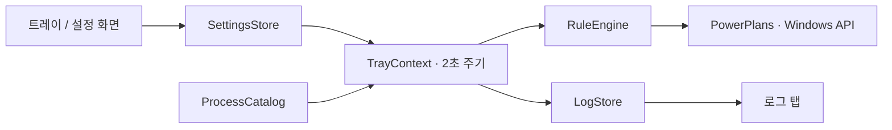

# PowerShift 설계

최종 검토: 2026-11-03. v0.4.0의 구조와 `Unreleased` 보안 보강 기준. 배포본의 앱 실행 파일 버전은 v0.3.1입니다.
이 문서는 현재 구현을 설명합니다. 출시 이력은 [CHANGELOG](../CHANGELOG.md), 배포 절차는 [RELEASING](RELEASING.md)을 참고하세요.

## 목적과 범위

트레이에서 기본 전원 구성표를 고르고, 실행 중인 프로그램에 따라 임시로 다른 구성표를 적용하는 Windows 유틸리티입니다.
Windows에 등록된 **전원 관리 구성표**를 전환합니다. Windows 설정의 별도 ‘전원 모드’ 슬라이더나 NVIDIA 드라이버 설정을 조작하지 않습니다.
구성표의 세부 값 변경, 새 구성표 생성, 상주 서비스, 네트워크 통신은 현재 기능에 포함되지 않습니다.

기본 실행 방식은 C# / WinForms / Windows .NET Framework 4.x입니다. 외부 런타임이나 NuGet 패키지를 설치하지 않습니다.
설치 프로그램은 Windows 10/11의 `x64compatible` 환경을 대상으로 하며 현재 사용자 권한으로 동작합니다.

## 구성

| 파일 | 책임 |
| --- | --- |
| `src/Program.cs` | 단일 인스턴스, 이벤트 루프, 규칙 평가, 실제 전환, 로그 기록, 정상 종료 |
| `src/PowerPlans.cs` | 구성표 열거, 이름 읽기, 활성 구성표 조회·전환 |
| `src/Settings.cs` | 설정 모델, 유효성 검사, 저장, 부작용 없는 규칙 선택 |
| `src/ProcessCatalog.cs` | 실행 프로세스 스냅샷과 필요한 EXE 경로 조회 |
| `src/Desktop.cs` | 아이콘, 현재 사용자 자동 실행, Windows 전원 옵션 열기 |
| `src/SettingsForm.cs` | 기본 설정과 프로그램 규칙 편집 |
| `src/ProcessPickerForm.cs` | 전체 경로로 구분하는 실행 중 프로그램 선택 |
| `src/LogStore.cs`, `src/LogsView.cs` | 로그 파일, 보관 기간 정리, 로그 목록·상세 표시 |
| `src/SafeStorage.cs` | 데이터 경로의 연결 확인, 읽기 크기 제한, 임시 파일의 배타적 생성 |
| `installer/PowerShift.iss` | 사용자별 설치, 시작 메뉴, 업그레이드, 제거 |
| `.github/workflows/build.yml` | Windows 빌드와 자동 검증 |

## 전원 선택 규칙

`DefaultPlanId`는 사용자가 정한 평소의 구성표입니다. 처음 실행해 설정이 없으면 현재 활성 구성표를 기본값으로 사용합니다.
이후에는 저장한 기본값을 적용합니다. 트레이의 **기본값 변경**과 설정 화면의 기본 전원 옵션 선택은 같은 값을 변경합니다.

자동 전환을 켠 경우, 저장된 규칙을 **위에서 아래로** 확인합니다. 사용 중이며 실행 프로세스와 일치하고 대상 구성표가 존재하는 첫 규칙을 선택합니다.
경로가 더 구체적인 규칙이라도 목록 아래에 있으면 위쪽의 이름 기준 규칙보다 우선하지 않습니다.
여러 EXE가 필요한 프로그램은 EXE별로 규칙을 추가합니다.

| 조건 | 적용 결과 |
| --- | --- |
| 적용 가능한 프로그램 규칙 존재 | 목록에서 가장 위에 있는 일치 규칙 |
| 일치 규칙 없음 / 자동 전환 꺼짐 | 저장한 기본값 |
| 규칙이 가리키는 구성표 삭제됨 | 해당 규칙을 건너뛰고 다음 규칙 확인 |
| 기본 구성표도 삭제됨 | 현재 활성 구성표 유지 |
| 동일한 EXE가 여러 인스턴스로 실행됨 | 일치하는 인스턴스가 하나라도 남아 있으면 규칙 유지 |

활성 규칙 중 기본값을 바꾸면 규칙은 계속 적용됩니다. 해당 규칙이 끝난 뒤 새 기본값으로 복귀합니다.
창의 포커스나 최소화 여부는 판단하지 않습니다. 백그라운드 프로세스도 실행 중인 것으로 취급합니다.
다른 도구가 활성 구성표를 변경하더라도 앱은 다음 평가 때 현재 규칙 또는 기본값을 재적용합니다.

## 프로세스 식별과 평가 주기

- 이름은 `.exe` 확장자를 제거해 대소문자 구분 없이 비교합니다.
- `ExecutablePath`가 있으면 전체 경로도 일치해야 합니다. 없으면 같은 이름의 모든 경로를 대상으로 합니다.
- 경로는 환경 변수, 따옴표, 경로 구분자, `.` 등의 상대 구성요소와 지원하는 확장 경로 접두사를 정규화합니다. 입력은 절대 경로여야 합니다.
- 동일한 이름과 정규화된 경로의 중복 규칙은 거부합니다. 이름이 같아도 경로가 다르면 등록할 수 있습니다.
- 경로를 읽지 못한 프로세스는 경로 지정 규칙에 일치하지 않습니다. 이름 기준 규칙은 별도로 적용될 수 있습니다.
- 파일 시스템의 심볼릭 링크·하드 링크·짧은 경로까지 같은 파일로 판정하는 기능은 없습니다.

WinForms 타이머는 2초마다 평가합니다. 사용 중인 자동 규칙이 없으면 프로세스를 열거하지 않습니다.
경로 조회는 경로 지정 규칙에 필요한 이름의 프로세스에만 수행합니다. 프로그램 선택 창을 열 때는 표시를 위해 모든 조회 가능한 경로를 수집합니다.
`OpenProcess(PROCESS_QUERY_LIMITED_INFORMATION)`와 `QueryFullProcessImageNameW`를 사용하며 조회 핸들은 반드시 닫습니다.

구성표 목록은 메뉴·설정 창을 열 때와 약 60초마다 다시 읽습니다. 실제 활성 구성표가 목표와 다를 때만 전환 API를 호출합니다.
UI 타이머이므로 시스템 부하와 UI 작업에 따라 평가가 지연될 수 있으며 실시간 반응을 보장하지 않습니다.

## Windows 전원 API와 인스턴스 수명

`PowerEnumerate` / `PowerReadFriendlyName`으로 등록된 구성표를 읽고, `PowerGetActiveScheme` / `PowerSetActiveScheme`으로 활성 상태를 제어합니다.
전환 후 실제 활성 GUID를 다시 확인합니다. OS가 할당한 GUID 메모리와 GDI 아이콘 핸들은 사용 후 해제합니다.

동일 로그온 세션에서는 이름 있는 뮤텍스로 한 인스턴스만 실행합니다.

| 식별자 | 용도 |
| --- | --- |
| `Local\PowerShift.3B8D7A3E` | 앱 단일 인스턴스 뮤텍스 |
| `Local\PowerShift.ShowSettings.3B8D7A3E` | 이미 실행 중인 앱의 설정 화면 열기 |
| `Local\PowerShift.Exit.3B8D7A3E` | 앱 정상 종료 요청 |

두 번째 실행은 기존 인스턴스에 설정 화면 열기를 요청하고 종료합니다. `--settings`는 첫 실행에서도 설정을 엽니다.
`--exit`는 기존 인스턴스에 정상 종료를 요청합니다. 정상 종료는 유효한 기본값을 복원하고 트레이 아이콘·타이머를 해제합니다.
강제 종료나 프로세스 충돌에서는 복원을 보장하지 않습니다. 여러 로그온 세션의 동시 설정 쓰기는 별도로 조정하지 않습니다.

## 설정 저장과 호환성

위치: `%APPDATA%\PowerShift\settings.json`. 설정 스키마 버전은 `1`입니다.

| 필드 | 의미 / 기본값 |
| --- | --- |
| `Version` | 설정 스키마 버전, `1` |
| `DefaultPlanId` | 기본 구성표 GUID; 첫 실행 시 현재 활성 구성표 |
| `AutomaticSwitching` | 프로그램별 자동 전환, `true` |
| `LogRetentionDays` | 로그 보관 일수, `3`; `0`은 자동 삭제 없음 |
| `Rules` | 우선순위대로 정렬된 규칙 목록 |
| `Rules[].Enabled` | 규칙 사용 여부 |
| `Rules[].ProcessName` | 확장자를 제거한 프로세스 이름 |
| `Rules[].ExecutablePath` | 선택적인 전체 경로; 이전 버전 규칙은 이름 기준 유지 |
| `Rules[].PlanId` | 적용할 구성표 GUID |

설정 화면은 복사본을 편집하며 **저장**할 때만 적용합니다. 취소는 실시간 규칙을 바꾸지 않습니다.
저장은 같은 폴더의 임시 파일에 쓴 뒤 `File.Replace` 또는 최초 `File.Move`로 교체합니다.
유효하지 않은 설정이나 지원하지 않는 스키마는 오류로 알리고 원본을 자동 덮어쓰지 않습니다.
`Unreleased`에서는 읽기 전 파일 크기를 1MiB로 제한하고 JSON 깊이를 16으로 제한합니다. 연결된 설정 폴더/파일로의 접근은 거부합니다.
보관 기간 필드가 없는 기존 설정은 생성자의 기본값 3일로 읽으며, 명시적으로 저장된 0은 유지합니다.

## 감사 로그

위치: `%APPDATA%\PowerShift\logs\PowerShift-yyyy-MM-dd.jsonl`. UTC 날짜별 UTF-8 JSON Lines 파일입니다.
화면의 시간은 현지 시간으로 변환합니다.

각 항목은 `TimestampUtc`, `Level`, `FromPlan`, `ToPlan`, `PreviousRule`, `Rule`, `ExecutablePath`, `Reason`을 저장합니다.
규칙 이름에는 당시 목록 순서와 EXE 이름을 넣어, 어떤 규칙으로 이전 모드에서 새 모드로 전환됐는지 남깁니다.

- 실제 전환, 모드는 같지만 적용 규칙이 바뀐 경우, 전원 전환 실패를 기록합니다.
- 프로그램 종료에 따른 기본값 복귀, 자동 전환 해제, 기본값 변경, 외부 변경 후 재적용, 앱 종료 시 복귀를 구분합니다.
- 상태가 같은 반복 평가와 같은 전환 오류의 반복 기록을 억제합니다.
- 로그 저장 실패는 전원 전환을 중단하지 않으며 로그 탭에서 오류를 표시합니다.
- 화면에는 최신 500개를 표시합니다. 저장 파일의 개수를 500개로 제한하는 것은 아닙니다.

`Unreleased` 보강은 화면 읽기를 파일 끝부분부터 총 4MiB로 제한하고, 제한이 적용되면 일부 표시임을 알립니다.
로그 한 줄은 최대 128Ki 문자이며, 보관 처리는 생존 행 전체를 메모리에 모으지 않고 임시 파일에 순차 기록합니다.
허용 크기를 넘는 항목 등으로 정리에 실패하면 원본을 유지합니다. 연결된 로그 폴더 및 데이터 상위 폴더는 거부하고 연결된 로그 파일은 제외합니다.

보관 기간은 경과한 24시간 단위입니다. 앱 시작, 설정 저장, 실행 중 약 1시간마다 만료 항목을 정리합니다.
`현재 UTC 시각 - 보관 일수`보다 **이전**인 항목만 지우므로 경계와 정확히 같은 시각은 남깁니다.
0이면 자동 정리를 건너뜁니다. 해석할 수 없는 항목과 앱 로그 이름 형식에 맞지 않는 파일은 보존합니다.
파일의 일부만 만료됐으면 임시 파일로 교체하고, 남는 항목이 없으면 해당 로그 파일을 삭제합니다.

## 화면과 아이콘

설정은 **기본 설정 / 프로그램별 설정 / 로그** 탭으로 구성합니다.
규칙 목록과 실행 중 프로그램 선택 표의 마지막 열에 전체 경로를 표시합니다.
트레이에서 체크된 구성표는 저장된 기본값이며, 상단 상태와 툴팁은 현재 적용된 구성표와 규칙을 표시합니다.

| 구성표 | 아이콘 배경 |
| --- | --- |
| 절전 | 노랑 `#EAB308` |
| 균형 조정 | 초록 `#2AAE75` |
| 고성능 | 파랑 `#3F8FEB` |
| 사용자 구성표 | 초록 |

## 설치·업데이트·제거

Inno Setup 설치 프로그램은 기본적으로 `%LOCALAPPDATA%\Programs\PowerShift`에 EXE와 README를 설치합니다.
현재 사용자 시작 메뉴에 설정 화면 바로가기를 만들고 Windows 설치된 앱 목록에 제거 항목을 등록합니다.
로그인 자동 실행은 `HKCU\Software\Microsoft\Windows\CurrentVersion\Run\PowerShift`에 실행 파일 경로를 기록합니다.

자동 실행 선택은 설치 마법사에서 변경할 수 있습니다. 기존 포터블 자동 실행 설정을 반영하며, 무인 설치의 명시적 작업 선택을 우선합니다.
업데이트는 종료 이벤트로 앱을 정상 종료하고 뮤텍스 해제를 기다립니다. 종료되지 않으면 교체를 진행하지 않습니다.
제거도 정상 종료를 요청하며, 해당 설치 경로를 가리키는 자동 실행 항목만 삭제합니다.
설정과 로그는 설치 폴더 밖에 있어 업데이트·제거 후에도 유지됩니다.

ZIP 방식은 `Setup.ps1`로 폴더 내부와 시작 메뉴에 바로가기를 만듭니다. `-EnableStartup`으로 자동 실행을 등록합니다.
`-ScriptHost`는 Windows PowerShell에서 같은 C# 소스를 실행하는 선택적인 호스팅 방식이며 OS 보안 정책의 적용을 받습니다.

## 보안과 배포 제약

현재 앱·설치 파일은 코드 서명되지 않았습니다. GitHub 공개, 시작 메뉴 등록, 설치 프로그램 제공만으로 Smart App Control의 신뢰가 생기는 것은 아닙니다.
보안 기능을 켠 상태에서 안정적으로 배포하려면 신뢰된 코드 서명 인증서 또는 서명 서비스를 준비하고 앱·설치·제거 산출물을 서명해야 합니다.
컴파일러 다운로드의 서명 검증은 공급 도구의 검증이며, PowerShift 산출물 자체에 코드 서명을 부여하지는 않습니다.

설정과 로그는 로컬 데이터이며 Git과 배포 파일에 포함하지 않습니다. 런타임은 원격 통신을 수행하지 않습니다.
Smart App Control 재활성화 가능 여부는 Windows 버전·업데이트와 장치 정책에 따라 달라집니다. 앱의 설치나 정상 동작 검증과 분리해서 확인합니다.

## 검증과 남은 과제

| 검증 | 범위 |
| --- | --- |
| `Test.ps1` | 규칙 우선순위, 경로 매칭, 설정·로그 제한, 보관 기간, junction 회귀; 현재 소스 58개 검사 (v0.4.0은 43개) |
| `Test.ps1 -Integration` | 실제 구성표 전환과 원상 복구, 프로세스 및 EXE 경로 조회 |
| `tests/SmokeTest.ps1` | 실제 트레이 루프, 다른 경로의 같은 EXE, 다중 인스턴스, 복귀와 로그 중복 억제 |
| `tests/InstallerTest.ps1` | 설치, 실행 중 업데이트, 자동 실행 선택·변경, 제거, 설정·로그 보존; 현재 CI 20개 검사 |

CI는 Windows에서 앱과 설치 파일을 빌드합니다. 공식 컴파일러 패키지의 고정 SHA-256과 Authenticode 서명을 확인하고 GitHub Actions도 커밋 SHA로 고정합니다.
v0.4.0은 [Windows 검증 작업](https://github.com/ParkDyel/PowerShift/actions/runs/41603226113)에서 검증했습니다.
개발 PC에서는 앱 제어 정책으로 설치 EXE 실행이 차단되어 해당 설치 검증은 별도 Windows 실행 환경에서 수행했습니다.

향후 검토 항목은 신뢰된 코드 서명, 긴 경로·파일 별칭 식별, 여러 로그온 세션의 설정 쓰기 조정, 프로세스 이벤트 기반 감지입니다.
이 항목들은 현재 구현된 기능이나 배포 일정에 대한 약속이 아닙니다.
`Unreleased` 보강의 위협 모델, 검증과 한계는 [보안 검토](SECURITY_REVIEW.md)를 참고하세요.

## 참고

- [Windows 전원 구성표 API](https://learn.microsoft.com/en-us/windows/win32/api/powersetting/nf-powersetting-powersetactivescheme)
- [프로세스 전체 경로 조회 API](https://learn.microsoft.com/en-us/windows/win32/api/winbase/nf-winbase-queryfullprocessimagenamew)
- [Smart App Control용 코드 서명](https://learn.microsoft.com/en-us/windows/apps/develop/smart-app-control/code-signing-for-smart-app-control)
- [Inno Setup](https://jrsoftware.org/isinfo.php)
